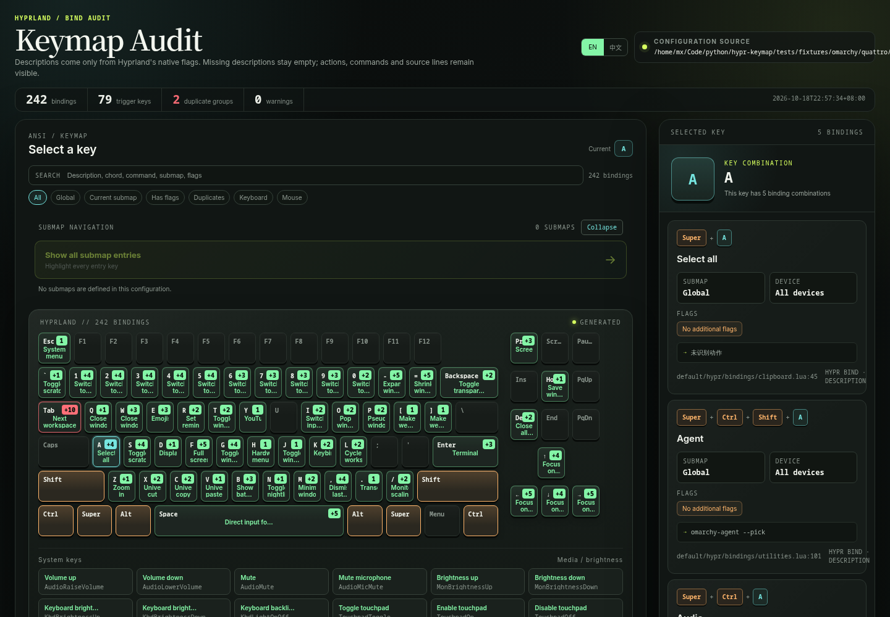
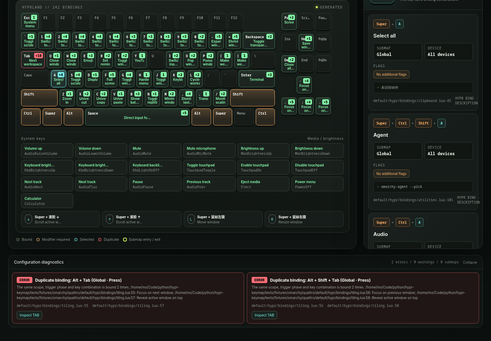

# hypr-keymap

Generate an interactive, searchable, and diagnostic keyboard audit from a Hyprland Lua configuration.

`hypr-keymap` is designed for Hyprland setups that use Lua configuration files. It does not depend on a hard-coded keymap or manually maintained documentation. Binding descriptions come directly from Hyprland's native `description` field, while actions, commands, flags, submaps, and source locations are extracted from the real configuration.



## Why

Hyprland Lua configurations are commonly split across multiple files with `require`. As a configuration grows, it becomes difficult to answer questions such as:

- Is the same key combination bound more than once?
- Are any bind flags conflicting or redundant?
- Which keys are available only inside a submap?
- Does the documentation still match the current configuration?
- What does a particular key actually do?

`hypr-keymap` turns the effective configuration into a complete keyboard view for browsing, searching, and auditing, while also reporting likely configuration problems.

## Features

### Load from the Hyprland entry file

Pass only `hyprland.lua`. The tool follows the Lua `require` graph to load the binding files:

```lua
require("./configs/*")
```

Supported import forms include:

- Relative paths: `require("./configs/binds.lua")`
- Dotted module names: `require("configs.function")`
- Globs: `require("./configs/*")`
- Module return values and normal Lua `require` caching
- Real source names and line numbers for every binding, such as `configs/binds.lua:20`

To avoid executing arbitrary modules, the extractor only loads Lua files
discovered beneath the configured module roots.

For layouts such as Omarchy, where modules live under both `~/.config` and
`OMARCHY_PATH`, additional roots can be supplied explicitly:

```bash
hypr-keymap ~/.config/hypr/hyprland.lua \
  --module-root ~/.config \
  --module-root /usr/share/omarchy
```

When the entry is under `XDG_CONFIG_HOME`, that directory is added
automatically. `OMARCHY_PATH` is also used automatically when it exists.

### Interactive keyboard audit

- ANSI keyboard layout plus mouse, media, and function keys
- Click any key to inspect its key combination, command, devices, and flags
- Submap overview, member view, and double-click navigation
- Distinct styling for submap entries, exits, and their required modifiers
- Ordinary submap members keep the normal binding style
- Arrow-key navigation and accessible key labels

### Search

Press `/` or `Ctrl+K` to open search.

Plain text and field-qualified searches are supported:

```text
SUPER A
SUPER + A
super+a
key:super+a
submap:resize
flag:repeating
device:keyboard
command:playerctl
action:window
```

### Configuration diagnostics

Diagnostics are shown at the bottom of the generated page and include:

- Duplicate key combinations
- Overlaps within the same scope, trigger phase, and device range
- Semantic overlaps caused by `ignore_mods` or `submap_universal`
- Unknown or incorrectly typed bind flags
- Conflicts between `release`, `long_press`, `click`, and `drag`
- Duplicate modifiers and unknown key names

Use `--check` to run diagnostics in the terminal without generating HTML.

### English and Chinese UI

- The UI defaults to English
- A language switch in the page header selects English or Chinese
- The selected language is stored locally and reflected in the URL as `#lang=zh`
- Hyprland `description` values are always displayed exactly as written and are never translated

### Self-contained output

The generated HTML embeds its styles, scripts, and binding data. It does not require a local server and does not access the network at runtime.

## What it found in Omarchy

The checked-in regression target is an Omarchy `quattro` snapshot pulled on
2026-10-18 from commit
[`a6dcc31b`](https://github.com/omacom/omarchy/tree/a6dcc31b6429fcf25e9e6bf90179f84c602cbf4e),
release `v4.0.5`.

`hypr-keymap` extracted 242 bindings and reported two potential duplicate
groups:

```text
ALT + TAB
  default/hypr/bindings/tiling.lua:55  Focus on next window
  default/hypr/bindings/tiling.lua:57  Reveal active window on top

ALT + SHIFT + TAB
  default/hypr/bindings/tiling.lua:56  Focus on previous window
  default/hypr/bindings/tiling.lua:58  Reveal active window on top
```

Omarchy intentionally stacks two dispatchers for each chord. The reverse
chord has a known behavioral problem:

- [Omarchy issue #7561: Alt+Shift+Tab cycles between only two windows](https://github.com/omacom/omarchy/issues/7561)
- [Omarchy PR #8576: Cycle backwards through every window](https://github.com/omacom/omarchy/pull/8576)

The issue explains that `cycle_next()` walks window z-order while
`bring_to_top()` mutates the same order, causing reverse cycling to bounce
between two windows. The proposed fix lowers the window being left before
cycling backward.



## Related projects

Other Hyprland keybinding tools I found take different approaches:

- [HyprBind](https://github.com/ry2x/HyprBind) — simple keybinding viewer
- [rofi-hyprland-keybinds-cheatsheet](https://github.com/jason9075/rofi-hyprland-keybinds-cheatsheet) — Rofi cheatsheet
- [hyprland-keybind-menu](https://github.com/kolbenhans/hyprland-keybind-menu) — searchable and executable Lua keybind menu
- [hyprkeybind-show](https://github.com/val7tools/hyprkeybind-show) — CLI keybinding listing with source locations
- [OmarKEYs](https://github.com/romills/OmarKEYs) — live Hyprland keymap overlay

`hypr-keymap` focuses on a self-contained browser view of the complete
keyboard, Lua `require` graph analysis, submap navigation, flag-aware
diagnostics, and English/Chinese UI.

See [docs/ECOSYSTEM.md](docs/ECOSYSTEM.md) for the GitHub/Reddit landscape,
feature comparison with hyprKCS, and launch positioning.

See [ROADMAP.md](ROADMAP.md) for the recorded project status, Omarchy findings,
known limitations, and next release milestones.

## How it works

The tool executes the configuration entry in a restricted Lua environment:

- Calls such as `hl.bind()` and `hl.define_submap()` are captured
- `hl.dsp.*` actions retain their action path and arguments
- Non-binding calls such as `hl.window_rule()` and `hl.monitor()` are accepted by proxy objects
- `require` is resolved by the tool instead of the system Lua module path

This process only reads the configuration and builds audit data. It does not modify Hyprland state or execute the commands assigned to bindings.

## Requirements

- Linux
- Python 3.11 or newer
- Lua 5.1, 5.2, 5.3, 5.4, or LuaJIT
- [uv](https://docs.astral.sh/uv/)
- Chromium: only required for the UI regression test
- `xdg-open`: only required when using `--open`

## Quick start

From the repository root:

```bash
uv sync
uv run hypr-keymap --open
```

When no path is provided, the tool looks for:

```text
~/.config/hypr/hyprland.lua
```

You can also provide the entry explicitly:

```bash
hypr-keymap ~/.config/hypr/hyprland.lua --open
```

Default output:

```text
~/.cache/hypr-keymap/index.html
```

Write to a specific location:

```bash
hypr-keymap ~/.config/hypr/hyprland.lua -o /tmp/keymap.html --open
```

Run diagnostics only:

```bash
hypr-keymap ~/.config/hypr/hyprland.lua --check
```

In check mode, the exit code is `1` when an error-level diagnostic is found.

## Configuration

Add functional descriptions through Hyprland's native `description` field:

```lua
hl.bind(
  mainMod .. "Q",
  hl.dsp.exec_cmd("kitty"),
  { description = "Open terminal" }
)
```

The tool does not infer descriptions from commands, action paths, or key names. Bindings without `description` are still listed, but no description is invented.

## Build

Build the wheel and source distribution from the repository root:

```bash
uv build
```

Artifacts are written to:

```text
dist/
├── hypr_keymap-1.10.0-py3-none-any.whl
└── hypr_keymap-1.10.0.tar.gz
```

For an offline build:

```bash
uv build --offline
```

An offline build requires `uv_build` to be available in the local cache.

## Install

### Editable installation

Use an editable installation during development:

```bash
uv tool install --editable .
```

Changes under `src/hypr_keymap/` take effect immediately. Reinstall when dependencies, entry points, or build configuration change:

```bash
uv tool install --force --editable .
```

### Wheel installation

For a fixed version:

```bash
uv build
uv tool install --force \
  dist/hypr_keymap-1.10.0-py3-none-any.whl
```

Inspect the installation locations:

```bash
uv tool dir
uv tool dir --bin
```

Default command path:

```text
~/.local/bin/hypr-keymap
```

Default tool environment:

```text
~/.local/share/uv/tools/hypr-keymap/
```

## Omarchy compatibility fixture

The repository includes an unmodified Omarchy Hyprland configuration snapshot
pinned to commit `a6dcc31b6429fcf25e9e6bf90179f84c602cbf4e`. Its source,
license, and reproduction notes are recorded in
`tests/fixtures/omarchy/quattro/UPSTREAM.md`.

- Pulled: 2026-10-18
- Branch: `quattro`
- Release at capture time: `v4.0.5`

Run the regression assertions:

```bash
uv run python tests/omarchy_snapshot.py
```

The snapshot keeps Omarchy's upstream layout. The test points directly at
`config/hypr/hyprland.lua`, supplies `config` and `OMARCHY_PATH` as additional
Lua module roots, and uses an isolated HOME. It does not copy or rewrite the
configuration tree.

Generate the audit report and open it in the default browser:

```bash
uv run python tests/omarchy_snapshot.py --open
```

Choose an output path explicitly:

```bash
uv run python tests/omarchy_snapshot.py \
  -o /tmp/omarchy-keymap.html --open
```

Without `--open`, the script performs the extraction and validation without
writing HTML unless `--output` is provided.
